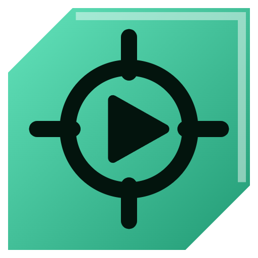
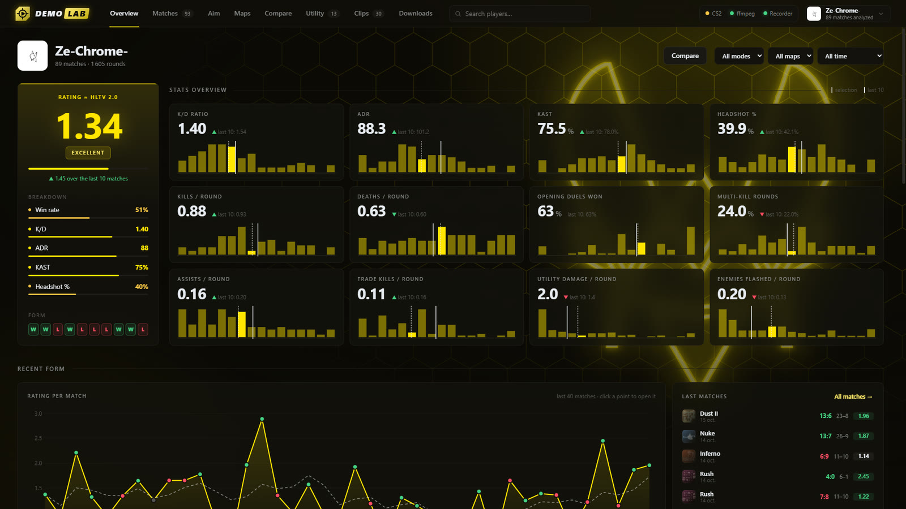
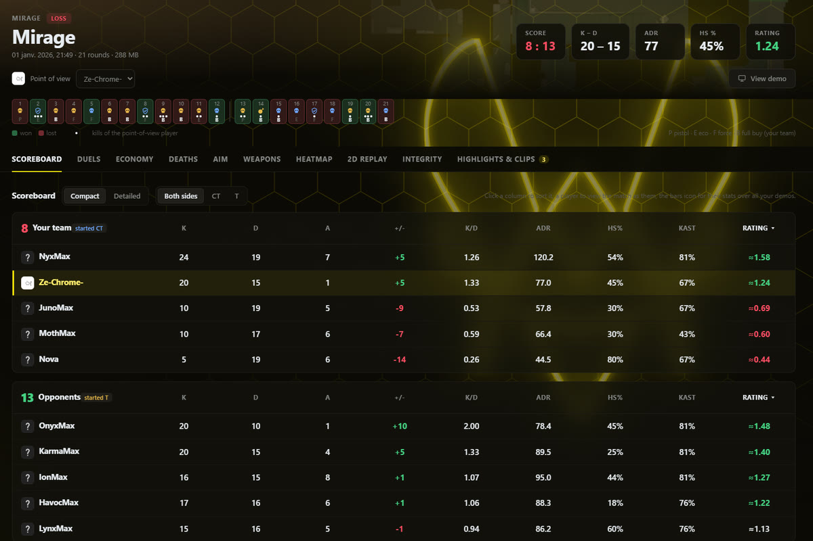
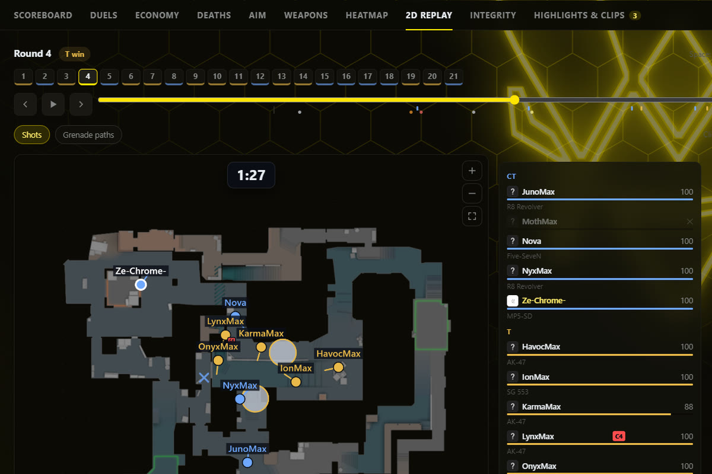
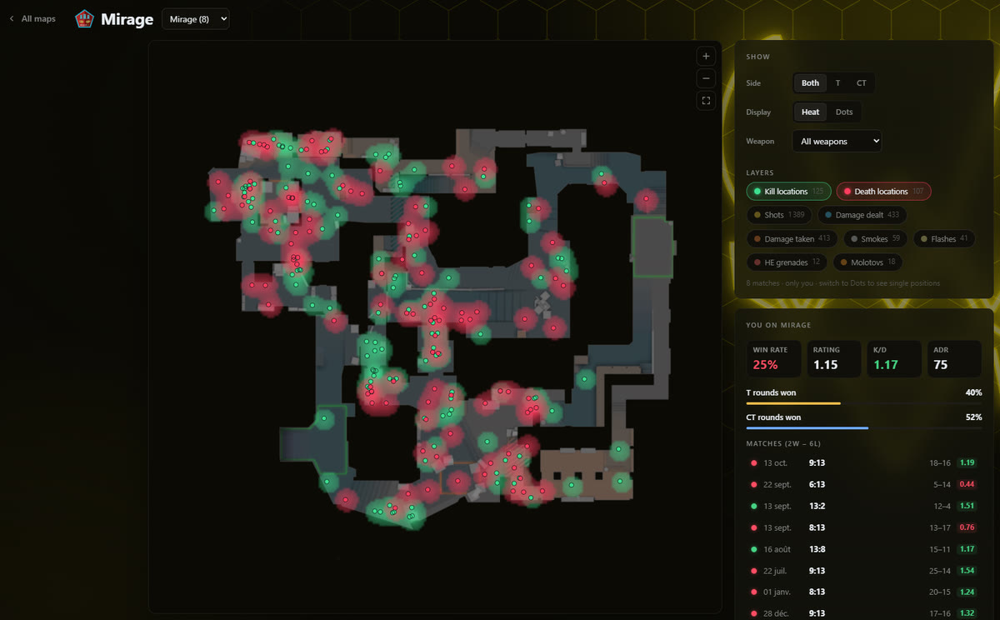
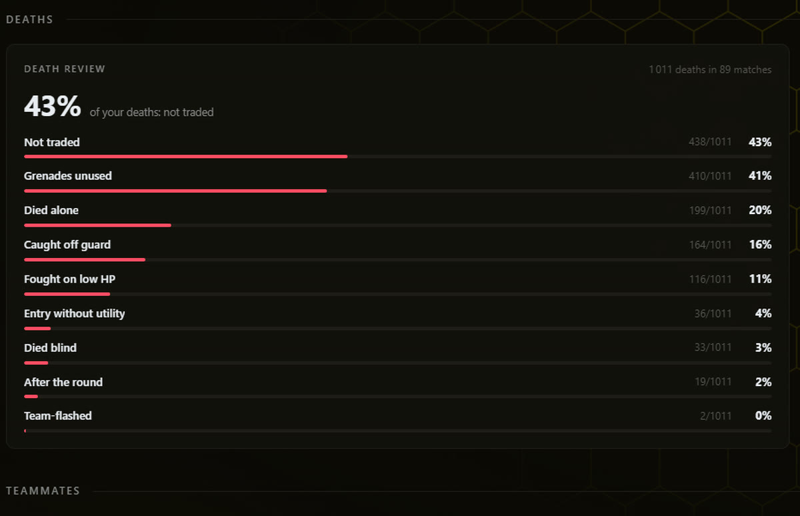
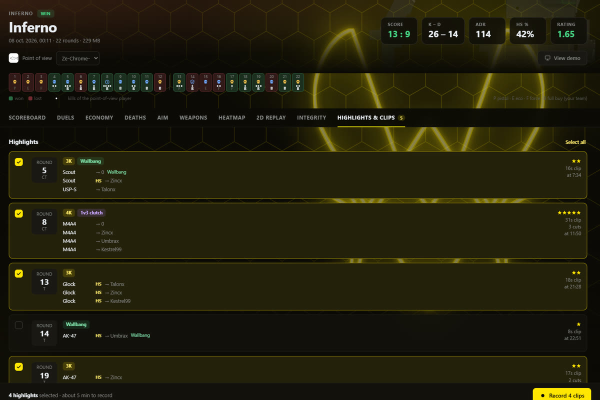
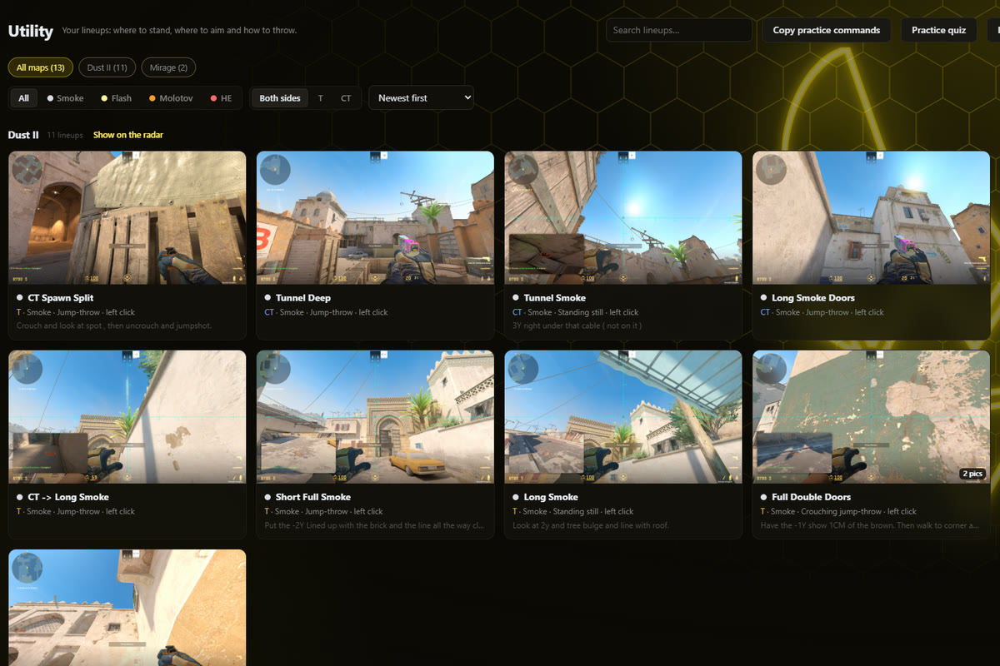
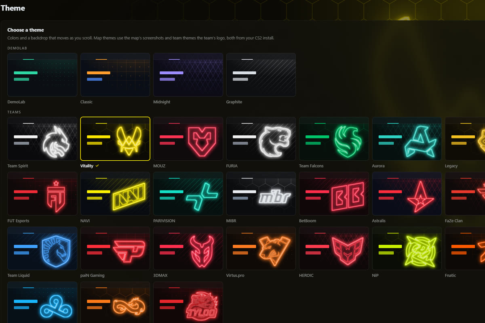
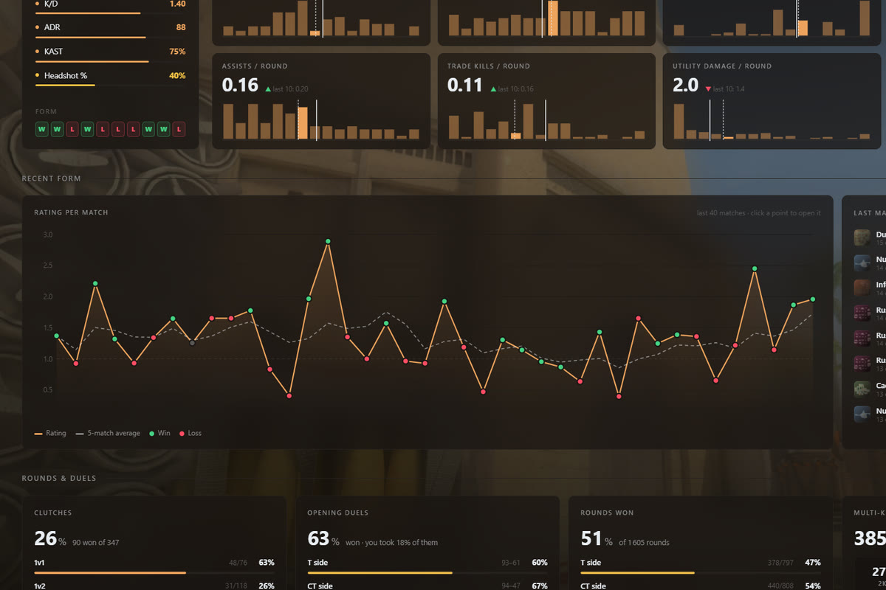

<p align="center">
  
</p>

<h1 align="center">CS2 DemoLab</h1>

<p align="center">
  <b>Stats, 2D replays, lineups and highlight clips from your CS2 demos. Everything runs on your PC.</b>
</p>

<p align="center">
  
  
  
  
</p>

<p align="center">
  <a href="https://github.com/Ze-Chr0ME/demo_lab/releases"><b>Download</b></a> ·
  <a href="#-features">Features</a> ·
  <a href="#-install">Install</a> ·
  <a href="#-making-clips">Making clips</a> ·
  <a href="#-troubleshooting">Troubleshooting</a> ·
  <a href="#-under-the-hood">Under the hood</a>
</p>

<p align="center">
  
</p>

DemoLab reads each of your demos once and turns them into a stats dashboard, per-match breakdowns,
heatmaps and a 2D replay. It also spots your best moments (multi-kills, clutches, no-scopes, wallbangs…)
and records them as clips through [HLAE](https://www.advancedfx.org/) while you keep using your PC.
No website, no upload, no subscription.

## ✨ Features

| Feature | What you get |
| --- | --- |
| 📊 **Overview** | ≈ HLTV 2.0 rating, K/D, ADR, KAST, opening duels, clutches, maps, weapons and teammates, with a histogram for every stat |
| 🧾 **Match pages** | Scoreboard, duels, economy, deaths, aim, weapons, heatmap, 2D replay and an integrity check for every match |
| 🎥 **2D replay** | Every round with players, view directions, utility, the bomb and a kill feed |
| 🗺️ **Maps** | Zoomable heatmaps of kills, deaths, damage and grenades over all your matches on a map |
| 💀 **Death review** | Every death checked for what went wrong: died alone, not traded, grenades unused, caught off guard… |
| ⚖️ **Compare** | You against any player from your demos, or against the median of your lobbies |
| 💰 **Inventory** | What your CS2 items are worth (Steam Market or Skinport prices, in your currency), item by item with floats, patterns and stickers, plus the value over time |
| 💨 **Utility** | A library of your grenade lineups, with a practice quiz and share codes for Discord |
| 🎬 **Clips & montages** | Multi-kills, clutches and special kills recorded in the background and joined into montages |
| 📥 **Auto downloads** | New matches pulled from Steam, including Scrimmage and Rush replays |
| 🎨 **Themes** | Neon team logos and map backdrops taken from your own CS2 install |

## 📸 Screenshots

<table>
  <tr>
    <td width="50%"><p align="center"><b>Match scoreboard</b> with a round-by-round timeline</p></td>
    <td width="50%"><p align="center"><b>2D replay</b> of every round</p></td>
  </tr>
  <tr>
    <td width="50%"><p align="center"><b>Maps</b>: heatmaps over all your matches</p></td>
    <td width="50%"><p align="center"><b>Death review</b>: what keeps killing you</p></td>
  </tr>
  <tr>
    <td width="50%"><p align="center"><b>Highlights</b> ready to record</p></td>
    <td width="50%"><p align="center"><b>Utility</b> lineup library</p></td>
  </tr>

  <tr>
    <td width="50%"><p align="center"><b>Team themes</b>: logos as neon signs</p></td>
    <td width="50%"><p align="center"><b>Map themes</b>: a backdrop that moves as you scroll</p></td>
  </tr>
</table>

## 🚀 Install

### Installer (recommended)

1. Download **`CS2-DemoLab-Setup-<version>.exe`** from the [releases page](https://github.com/Ze-Chr0ME/demo_lab/releases) and run it.
   It installs for your Windows account only (no admin rights), with ffmpeg included.
2. Open **Settings → Recording** and click **Check for updates → Install HLAE**.
3. Check that the status panel shows **CS2**, **Steam**, **ffmpeg** and **HLAE** in green.

> [!NOTE]
> You also need **Steam**, **CS2** and the [Visual C++ Redistributable x64](https://aka.ms/vs/17/release/vc_redist.x64.exe)
> (Steam games usually install it already). An installed DemoLab keeps itself up to date.

> [!TIP]
> HLAE injects into CS2, so some antivirus programs quarantine it. If that happens, restore it or add an
> exclusion for `%APPDATA%\cs2-demolab\hlae`.

### From the source

<details>
<summary>Requirements and steps</summary>

You need:

- **Windows 10/11 (64-bit)** with **Steam** and **CS2** (start CS2 once so its folders exist)
- **[Node.js](https://nodejs.org) 22.12+** (LTS)
- **ffmpeg** with `ffprobe`, for example the [gyan.dev essentials build](https://www.gyan.dev/ffmpeg/builds/)
  or `winget install Gyan.FFmpeg`. DemoLab looks on your `PATH`, in `C:\ffmpeg\bin` and in `C:\ffmpeg`;
  anywhere else, set it in **Settings → Output → ffmpeg**. `ffprobe.exe` must sit next to `ffmpeg.exe`.
- The **[Visual C++ Redistributable x64](https://aka.ms/vs/17/release/vc_redist.x64.exe)**, used by the demo parser

Then:

1. Double-click **`Start DemoLab.bat`**. The first launch runs `npm install` and downloads Electron, which
   takes a few minutes. (Or run `npm install` then `npm start`.)
2. Install HLAE from **Settings → Recording**, as above.

To build the installer yourself: `npm install --no-save electron-builder@26`, then `npm run dist`. It copies
the ffmpeg and ffprobe found on your PC into the installer and writes it to `dist\`.

</details>

> [!NOTE]
> DemoLab used to be called **CS2 ClipMaker**. On its first start it moves `%APPDATA%\cs2-clipmaker` to
> `%APPDATA%\cs2-demolab`, so parsed demos, settings, HLAE, the Steam sign-in and lineups carry over.

## 🎬 Making clips

1. Download your matches in CS2 (**Watch → Your Matches**), or let the **Downloads** tab do it. They show up in DemoLab automatically.
2. **Close CS2.** Recording needs its own CS2 session, started through HLAE.
3. Open a match and go to **Highlights & clips**. The 2★-and-up highlights are already ticked.
4. Click **Record**. CS2 opens in a window and plays the demo. **Keep using your PC**: you can cover or
   minimize CS2 (minimized, it renders more slowly). It closes by itself when it's done.
5. Find your clips in the **Clips** tab and in `Videos\CS2 Clips`. Click them in order and hit **Create montage**.

## 🔎 What's in it

<details>
<summary><b>Overview</b>: your dashboard</summary>

<br>

- **Left:** your ≈ HLTV 2.0 rating with a breakdown (win rate, K/D, ADR, KAST, HS%) and your last 10 results.
- **Right:** twelve stat tiles (K/D, ADR, KAST, HS%, kills/deaths/assists per round, opening duels,
  multi-kill rounds, trades, utility damage, enemies flashed). Each has a histogram over your matches: the
  dashed line is the whole selection, the solid one your last 10 matches.
- **Below:** rating per match, recent matches, clutches (1v1…1v5), opening duels and rounds won per side,
  multi-kills, maps, weapons and the teammates you play with most.
- Filter by mode (5v5, Wingman, Rush), map and period. Click a result or a point on the chart to open the match.

**Compare** puts you next to any player from your demos, or next to **your lobbies** (the median of every
player in every demo you have). Each stat shows how many of your lobbies' player-matches it beats, so a
1.10 rating reads as "better than 68%". **Only your shared matches** compares two players on the same games.

</details>

<details>
<summary><b>Match pages</b>: scoreboard, duels, heatmap, 2D replay, integrity</summary>

<br>

| Tab | What it shows |
| --- | --- |
| **Scoreboard** | K/D/A, ADR, HS%, KAST and **≈ HLTV Rating 2.0** for every player. **Detailed** adds opening kills/deaths, multi-kills, clutches, trades, utility damage and flash assists |
| **Duels** | Who killed whom, for all kills or only each round's opening duel |
| **Deaths** | Your deaths in that match with their [death review](#death-review) tags, the killer, weapon and callout |
| **Heatmap** | Kills, deaths, shots, damage and grenades, split by side. This match or every match on that map. Floor switch on Nuke, Train and Vertigo |
| **2D Replay** | Players, view directions, health, weapons, smokes, fires, flashes, HEs, the bomb and a kill feed. `Space` play/pause · `←/→` 5 s · `↑/↓` round |
| **Integrity** | Red flags for cheating, per player, with the moments behind them ([details](#integrity-checks)) |
| **Highlights & clips** | The moments to record |

The rating uses the widely used community reconstruction of HLTV 2.0 (HLTV doesn't publish its formula), usually
within about ±0.02 of HLTV's number. Click a column to sort, or a player to view the match as them.
Double-click a match (or click the pencil) to rename it in DemoLab; the file keeps its name.

</details>

<details>
<summary><b>Maps</b> and <b>Aim</b></summary>

<br>

**Maps** lists every map you have demos of, with your record. Open one to see all its matches on one radar:
kills, deaths, shots, damage and grenades, for **you** or **everyone**, per side. **Dots** shows every
position, **Throw lines** connects each grenade to where it was thrown from (handy for lineups). Next to it:
win rate, rating, K/D, ADR and round win rate per side.

**Aim** is the match **Weapons** tab over all your matches: kills, HS %, damage, accuracy, kill types and
where your bullets land on the body, per weapon. Filter by mode, map, period, side and weapon type.

All radars zoom with the **mouse wheel**, **drag** to pan, and **double-click** (or ⤢) to reset.

</details>

<details id="death-review">
<summary><b>Death review</b>: what each tag means</summary>

<br>

The Overview adds your deaths up under **Deaths**; click a line to see those deaths, each one opening in its
match's 2D replay.

| Tag | Meaning |
| --- | --- |
| **Died alone** | Not traded, and no living teammate within 1,100 units, so nobody could trade you |
| **Not traded** | A teammate was close, but nobody killed your killer within 5 seconds |
| **Grenades unused** | You died with grenades in hand |
| **Entry without utility** | First death of a T round, with no team grenade landing near the fight |
| **Caught off guard** | The killer came into view with your crosshair 15°+ from their head, hit first and killed you (about the worst quarter of engagements in your lobbies). Measured matches only |
| **Fought on low HP** · **Died blind** · **Team-flashed** · **After the round** | As named (*after the round* = a saved gun lost) |

Descriptive tags: **Out-aimed** (your crosshair was close, they were faster), **Crossfire**, **Never saw them**,
**Hit first, lost** and **Opening death**.

Thresholds were checked on 1,015 deaths from 14 matches. The positions it needs are read once per demo
(about a second); older demos get them in the background.

</details>

<details>
<summary><b>Utility</b>: lineups and share codes</summary>

<br>

**Utility** keeps the grenade lineups you want to remember: where to stand, where to aim, how to throw,
pictures, and a practice quiz. **Share** copies a lineup (or **Share these** for the whole list) as a short
code like `DLU2-a1b2c3`, ready to paste in Discord: the lineups are a small file on catbox.moe and the code
is its name. If catbox can't be reached you get a long `DLU1-` code instead, which holds everything itself
(about 250 characters per lineup). **Import code** shows what's inside before adding anything and skips
lineups you already have. Pictures stay on your PC.

</details>

<details>
<summary><b>Themes</b></summary>

<br>

**Theme** (menu under your name, top right) changes the colors and the backdrop, which moves as you scroll:

- **Teams**: HLTV's top 15 first (Spirit, Vitality, MOUZ, FURIA, Falcons, Aurora, Legacy, G2, FUT, NAVI,
  PARIVISION, MIBR, BetBoom, Astralis, FaZe), then The MongolZ, Liquid, paiN, 3DMAX, Virtus.pro, HEROIC, NiP,
  Fnatic, ENCE, Cloud9, Eternal Fire, TYLOO. The logo becomes a neon sign over a pattern.
- **Maps**: Dust II, Mirage, Inferno, Nuke, Ancient, Anubis, Overpass, Vertigo, Train, Cache, Office, Italy.
  A screenshot of the map that slides and blurs as you scroll. Pick any of the 4–6 angles CS2 has.
- **DemoLab**: the app's own colors with a subtle pattern.
- **Your own**: any colors, any map picture or any of the ~145 team logos CS2 ships, and a pattern.

Logos and screenshots are read from your CS2 install (`pak01_dir.vpk`, see `src/lib/themeArt.js`) and cached
in `%APPDATA%\cs2-demolab\theme-art`. Nothing is downloaded.

The interface scales with the window (about 30% larger at 2560 × 1440, 80% at 3840 × 2160) and spreads
cards over the extra room. **Theme → Display** sets the size by hand.

</details>

<details>
<summary><b>Automatic match downloads</b></summary>

<br>

The **Downloads** tab collects your matches from two places and saves new demos to CS2's `replays` folder:

1. **Steam Community match history** (your private Personal Game Data pages). This is the **only** place that
   lists **Scrimmage** and **Rush** replays. Click **Sign in to Steam** once: Steam's own login page opens in
   a separate window, so the app never sees your password. **Sign out** clears it.
2. **Valve's recent-match list**, through the Steam client already running on your PC, like CS2's Watch tab.
   Only while CS2 is closed; Steam shows you as playing CS2 for about 5 seconds during the check.

- Checked every 30 minutes, or right away with **Check now**.
- Demos you already have under another name are recognized (map, rounds and players), so they aren't downloaded twice.
- A demo you deleted or moved is never downloaded again automatically (**Download again** still works).
- Valve deletes replays after a few weeks, so only recent matches can be downloaded.

</details>

<details>
<summary><b>New matches</b>: processed automatically</summary>

<br>

A new demo (from Downloads, CS2's Watch tab, or copied into a demo folder) is read and measured straight
away, and a Windows notification sums it up: score, your K–D, rating and ADR, highlights to clip and your
most common death mistake. Click it to open the match. While CS2 is running this works at below-normal
priority on fewer cores. **Settings → New matches** turns any of it off.

</details>

## 🧰 Troubleshooting

| Problem | Fix |
| --- | --- |
| "CS2 is already running normally" | Close CS2 completely (check Steam says it isn't running), then click **Record** again |
| CS2 opens but never records, or crashes after a CS2 update | Update HLAE in **Settings → Recording** |
| The first clip fails right after CS2 opens | Raise **CS2 startup wait** in **Settings → Advanced timing & commands** |
| "HLAE did not produce a video file" | Check the ffmpeg path in **Settings → Output** |
| Clips cut long pauses during clutches | Raise **Cut gaps longer than** in **Settings → Highlights** (e.g. 60 s) |
| Steam Community sign-in doesn't stick | Look at `%APPDATA%\cs2-demolab\demolab.log` |

Demos from game modes newer than the demo parser may not be readable.

## ⚙️ Under the hood

<details>
<summary><b>How recording works</b></summary>

<br>

- CS2 is started in a window through HLAE with `-insecure` (no VAC servers) and `-afxFixNetCon`, and driven
  through its console port. CS2 never needs focus.
- HLAE's `mirv_streams` records frames straight from the engine at a fixed frame rate (60 fps by default) and
  encodes them with ffmpeg; `mirv_cmd` starts and stops each recording on the exact demo tick.
- CS2 is **always closed** when recording ends. Never use an HLAE / `-insecure` CS2 session to join matches.
- HLAE has to match the installed CS2 version. DemoLab checks for new HLAE releases at startup and every
  6 hours; after a CS2 update, install the new one from **Settings → Recording**.
- HLAE is looked for in `%APPDATA%\cs2-demolab\hlae`, then in the project's `tools\hlae` (**Browse** picks another folder).

</details>

<details id="integrity-checks">
<summary><b>Integrity checks</b></summary>

<br>

Not proof, just moments worth watching; each opens in the 2D replay or in CS2 from that player's eyes.
An "unknown" enemy is behind a wall, not seen by anyone on the team or on the radar for 2 s, and silent
(no footsteps or shots within earshot).

- **No-mouse aim**: the view snaps onto an enemy and the player fires, while the recorded mouse movement can't account for the turn.
- **Tracked through walls**: the crosshair follows an unknown enemy behind a wall.
- **Aim behind walls**: how often the crosshair rests on unknown enemies, compared with the lobby.
- **Pre-aimed appearances**: how often the crosshair is already on an unknown enemy the moment they appear.
- **Wall hits**: hits through walls on unknown enemies.

Thresholds come from 532 player-matches; about 1 in 70 normal players gets "unusual". Line of sight uses each
map's collision mesh from [awpy-data](https://github.com/pnxenopoulos/awpy-data) (57 MB, downloaded once and
checked against the release's sha256); without it the game's radar spotting is used, which lags behind quick
peeks. Smokes and doors aren't taken into account. The first time a match's Integrity tab opens, every tick is
read (under a minute). Information-only cheats (radar hacks) usually don't show in a single match.

</details>

<details>
<summary><b>Each demo is read only once</b></summary>

<br>

Demos are recognized by their content (size plus a hash of the first and last 256 KB), not their file name,
so renaming, moving or copying one never makes DemoLab read it again. Results live in
`%APPDATA%\cs2-demolab\demo-data`. They are raw facts (kills, damage, shots, grenades with positions) and
stats are computed when shown, so new stats or formula changes don't need a re-read. Demos are re-read only
when an update changes what is extracted.

The radar images come from CS2's files and are bundled in `src/renderer/radar`. After Valve changes a map,
regenerate them with `node scripts/extract-radars.js <Source2Viewer-CLI.exe> <...gamecsgo>` (Source2Viewer's
`cli-windows-x64.zip` from [its releases](https://github.com/ValveResourceFormat/ValveResourceFormat/releases)).

</details>

<details>
<summary><b>Demo parser (Rush support)</b></summary>

<br>

The official `@laihoe/demoparser2` (0.42.0) can't read Rush (`rush_001`) demos, so DemoLab ships its own build
in `vendor/demoparser2/`: upstream master `45ca85a` plus `rush-fixes.patch`, which

1. looks serializers up by name **and version** (Rush maps send several versions of `CBodyComponentBaseModelEntity`), and
2. decodes 32-bit `qangle_precise` fields (used by Rush's conveyor belts) as 3 raw floats.

On 53 non-Rush demos the output is byte-for-byte identical to the npm package, and all 10 Rush demos parse.
`src/lib/parser.js` falls back to the npm package if the vendored build can't load (for example without the
Visual C++ runtime); `DEMOLAB_PARSER=npm` forces it.

To rebuild: install Rust, clone LaihoE/demoparser, apply the patch, make `src/csgoproto/build.rs` an empty
`fn main() {}` (otherwise it needs `protoc`), remove `features = ["voice"]` from `src/node/Cargo.toml`, run
`cargo build --release` in `src/node`, and copy `target/release/laihoe_demoparser2.dll` to
`vendor/demoparser2/demoparser2.win32-x64-msvc.node`.

</details>

<details>
<summary><b>Updates and releases</b></summary>

<br>

An installed DemoLab checks for a new [GitHub release](https://github.com/Ze-Chr0ME/demo_lab/releases) at
start and every 6 hours, downloads it in the background (checked against GitHub's sha256) and shows an
**Update** button in the top bar that restarts into the new version. Otherwise it installs when you close
DemoLab. Matches, settings, lineups and the install folder are kept. **Settings → Updates** has the release
notes, "Check now" and the on/off switch. Run from the source, DemoLab only reports new releases (`git pull` to update).

To publish a release: raise `version` in `package.json`, commit and push, then run `npm run release` (notes from
the commits) or `npm run release -- notes.md`. It builds the installer and uploads it to a new `v<version>`
release with the GitHub CLI (`gh`).

</details>

<details>
<summary><b>Project layout</b></summary>

<br>

```
src/main.js              Electron main process, IPC
src/lib/demo.js          Demo → rounds/rosters/kills/damage/shots/grenades (demoparser2, in a worker)
src/lib/store.js         Content-based demo ids, parsed data, failures and custom names on disk
src/lib/stats.js         Scoreboard (KAST, ≈Rating 2.0, trades, clutches…) and duels
src/lib/heat.js          Heatmap points per player (or everyone), grenades with their throw spot
src/lib/profile.js       Your per-match summary for the overview and the Maps page
src/lib/rounds.js        Money, loadouts, callouts per round; positions and grenades at each kill
src/lib/deaths.js        Death review: tags for every death
src/lib/utility.js       Utility lineups on disk, share codes
src/lib/track.js         Sampled player positions for the 2D replay
src/lib/integrity.js     Aim/visibility anomalies per player (Integrity tab) and their scoring
src/lib/geometry.js      Map collision meshes (awpy-data download) and line-of-sight ray casts
src/lib/parser.js        Loads the vendored demo parser (or the npm one)
src/lib/highlights.js    Multi-kill / clutch / special-kill detection, clip segments
src/lib/hlae.js          Starting CS2 through HLAE, console port, HLAE updates
src/lib/recorder.js      Playback + recording orchestration
src/lib/ffmpeg.js        Mux, join, montage, thumbnails
src/lib/matches.js       Match downloads (gcWorker.js: Valve's list, community.js: Steam Community)
src/lib/steam.js         Finding Steam, CS2 and the logged-in account
src/lib/updater.js       DemoLab's own updates from GitHub releases
src/renderer/            UI (radar/: bundled radar images and their world coordinates)
scripts/extract-radars.js  Regenerates src/renderer/radar from a CS2 install
scripts/dist.js          Builds the installer (npm run dist)
scripts/release.js       Publishes it as a GitHub release (npm run release)
```

</details>
